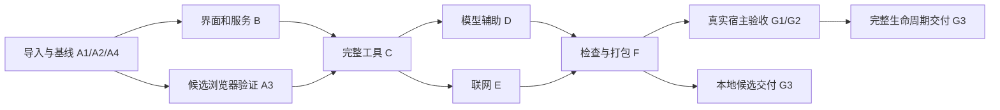

# Ctool 阶段与依赖

需求：[Product-Spec](Product-Spec.md)。设计：[High-Level-Design](High-Level-Design.md)。具体任务：[模块任务入口](doc/tasks/cookieos-migration/README.md)。实际状态和验证证据：[Progress](Progress.md)。

本文件仅维护阶段范围、依赖与任务链接；步骤、文件归属、命令、验收和失败处理位于对应任务文件。

## 阶段依赖

| 阶段 | 阶段范围 | 前置依赖 | 具体任务 |
|---|---|---|---|
| A | 来源、检查基线与可行性 | 无；内部 A1 → A2 → A4，A3 在 A2/A4 后验证候选 | [A1](doc/tasks/cookieos-migration/00-baseline.md#a1)、[A2](doc/tasks/cookieos-migration/00-baseline.md#a2)、[A4](doc/tasks/cookieos-migration/00-baseline.md#a4)、[A3](doc/tasks/cookieos-migration/00-baseline.md#a3) |
| B | 界面、偏好、服务与首条 Base64 路径 | A1、A2、A4；B1 → B2 → B3 | [B1](doc/tasks/cookieos-migration/01-shell-storage.md#b1)、[B2](doc/tasks/cookieos-migration/01-shell-storage.md#b2)、[B3](doc/tasks/cookieos-migration/02-service-contract.md#b3) |
| C | 完整工具迁移、安全边界与共享合同 | B3；C3 还依赖 A3；C3 → C1/C2 → C4 | [C3](doc/tasks/cookieos-migration/05-execution-safety.md#c3)、[C1](doc/tasks/cookieos-migration/03-data-encoding-text.md#c1)、[C2](doc/tasks/cookieos-migration/04-crypto-generation-dev.md#c2)、[C4](doc/tasks/cookieos-migration/06-shared-tools.md#c4) |
| D | 12 项宿主模型辅助 | B2、C4；D1 → D2 | [D1](doc/tasks/cookieos-migration/07-host-models.md#d1)、[D2](doc/tasks/cookieos-migration/07-host-models.md#d2) |
| E | 浏览器网络、ARM 与 JDoodle | B2/B3、C1；与 D 无硬依赖 | [E1](doc/tasks/cookieos-migration/08-network.md#e1)、[E2](doc/tasks/cookieos-migration/08-network.md#e2)、[E3](doc/tasks/cookieos-migration/08-network.md#e3) |
| F | 统一验证、审计、干净安装包 | C4、D2、E1/E2/E3；F1 → F2 → F3 | [F1](doc/tasks/cookieos-migration/09-build-package.md#f1)、[F2](doc/tasks/cookieos-migration/09-build-package.md#f2)、[F3](doc/tasks/cookieos-migration/09-build-package.md#f3) |
| G | 真实宿主验收、生命周期与交付 | F3；真实安装 G1 → 模型/AI/MCP G2 → 完整生命周期验收；本地候选交付可独立进行 | [G1](doc/tasks/cookieos-migration/10-acceptance.md#g1)、[G2](doc/tasks/cookieos-migration/10-acceptance.md#g2)、[G3](doc/tasks/cookieos-migration/10-acceptance.md#g3) |

建议主执行者按 A、B、C、D、E、F、G 顺序推进；图中独立路径表示依赖可分开验收，不表示授权多智能体协作。A3 失败只阻塞其依赖的执行安全路径；缺真实实例/凭据只阻塞相应真实验收，不把模拟或本地候选标成完整宿主验收。

## 范围追踪

- 60 项工具 / 88 登记入口：[逐项任务映射](docs/migration-matrix.md)。
- 14 个结构化公开操作：[C4](doc/tasks/cookieos-migration/06-shared-tools.md#c4)。
- 12 项原模型辅助：[D2](doc/tasks/cookieos-migration/07-host-models.md#d2)。
- 共通交接与完成条件：[任务目录说明](doc/tasks/cookieos-migration/README.md)。

## SDK 1.2.0 阶段与依赖

| 阶段 | 范围 | 依赖 | 模块任务 |
|---|---|---|---|
| S12-A | 盘点、运行与展示合同 | 无 | [01](doc/tasks/sdk-1.2-presentation/01-inventory-contract.md) |
| S12-B | 展示文档与真实媒体 | S12-A | [02](doc/tasks/sdk-1.2-presentation/02-presentation-assets.md) |
| S12-C | 构建、打包、市场导出 | S12-B | [03](doc/tasks/sdk-1.2-presentation/03-build-market.md) |
| S12-D | 隔离验收、发布产物、合回 | S12-C | [04](doc/tasks/sdk-1.2-presentation/04-host-acceptance-release.md) |

## 完整 AI/MCP 阶段与依赖

| 阶段 | 范围 | 前置依赖 | 模块任务 |
|---|---|---|---|
| FULL-A | 合同基线、完整映射与关键能力Spike | 无 | [00](doc/tasks/full-ai-mcp/00-contract-and-spikes.md) |
| FULL-B | 运行生命周期、文件传输、首条完整编码路径 | FULL-A；01 → 02 → 03 | [01](doc/tasks/full-ai-mcp/01-runtime-lifecycle.md)、[02](doc/tasks/full-ai-mcp/02-files-and-results.md)、[03](doc/tasks/full-ai-mcp/03-encoding-and-checksums.md) |
| FULL-C | 数据、密码学、文本代码、计算生成 | FULL-B；04 → 05 → 06 → 07 | [04](doc/tasks/full-ai-mcp/04-json-and-data.md)、[05](doc/tasks/full-ai-mcp/05-crypto-and-keys.md)、[06](doc/tasks/full-ai-mcp/06-text-and-code.md)、[07](doc/tasks/full-ai-mcp/07-time-and-calculation.md) |
| FULL-D | 图像、网络执行、宿主模型 | FULL-C；08还依赖FULL-A图像Spike；08 → 09 → 10 | [08](doc/tasks/full-ai-mcp/08-images.md)、[09](doc/tasks/full-ai-mcp/09-network-and-execution.md)、[10](doc/tasks/full-ai-mcp/10-host-models.md) |
| FULL-E | 完整覆盖、离线打包、隔离宿主与交付 | FULL-C/FULL-D；11 → 12 | [11](doc/tasks/full-ai-mcp/11-coverage-regression.md)、[12](doc/tasks/full-ai-mcp/12-package-and-host-acceptance.md) |

具体范围、文件归属、步骤、合同与验收只在[模块入口](doc/tasks/full-ai-mcp/README.md)及各模块文件，实际进度只在Progress维护。
