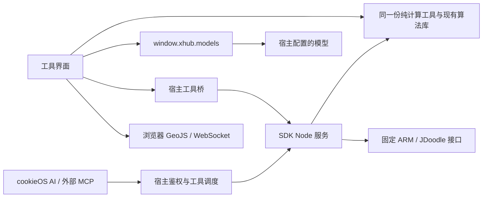

# Ctool 技术设计

## 加载性能设计增量（2026-10-31，待实施）

当前0.3.0仍为先读取全部允许偏好再挂载，完整功能/服务合同保持。本轮目标将启动分成轻量壳、必要设置、当前工具资源三部分，后两者在目标明确后并行，就绪后才开放对应交互；不以提前出现框架代替真实可用。

依赖方向收敛为“壳→纯元数据/偏好/路由；页面→所需业务/组件；编辑器→Monaco/语言Worker；任务→对应Worker能力”。基础共享函数/错误与工具注册分离，旧导出兼容；按键配置保留，不引入新存储、缓存框架、MCP实现或宿主改动。

本增量的目标时序替代后文第7节“先读完再挂载”的设计建议，当前代码尚未修改。实际测量、失败与并发保护、生命周期、性能预算见[DD-PERF](Detailed-Design.md#dd-perf-01-边界与复用)，任务见[模块入口](doc/tasks/loading-performance/README.md)。已有FULL等历史验收不代表本轮优化已通过。

依据：[需求](Product-Spec.md)、[迁移矩阵](docs/migration-matrix.md)、当前 SDK 1.2.0。本文规定实现边界，不表示对应代码已经存在。阶段依赖见 [DEV-PLAN.md](DEV-PLAN.md)，具体步骤与验收命令见 [模块任务](doc/tasks/cookieos-migration/README.md)。

## 1. 选择与理由

采用原 Vue 3 + TypeScript + Vite 界面，加 SDK Node 服务。原有工具、编辑器、格式转换库及测试优先复用；不重写 60 项算法，不开发第二套 UI，不替宿主实现模型代理、SSE 协议或 MCP 服务。

Node 服务用于结构化工具和需要秘密配置的外部请求。仅调用宿主模型的界面使用 `window.xhub.models`，不需要经过插件后端。Node主上下文不加载用户代码或执行调用方系统命令；既有JSON表达式仅在受限QuickJS中执行。

开发机基线 Node 22.22.2、Python 3.13.7。原项目声明 pnpm >=10，而本机是 9.15.3；项目以局部命令固定 `pnpm@10.34.9`，不升级全局工具。0.3.0运行端声明 `nodeVersion: ^22.22.2`（jsdom实际最低要求） 并以真实宿主安装验证为准。

## 2. 源码、模块与产物

```text
ctool/
├── Product-Spec.md / High-Level-Design.md / DEV-PLAN.md / Progress.md
├── package.json / pnpm-workspace.yaml / pnpm-lock.yaml
├── manifest.json                    # 插件身份与静态声明；tools 由注册表生成
├── packages/
│   ├── ctool-config/                 # 原工具分类、关键词与路由生成
│   ├── ctool-core/                   # 原 Vue 页面、组件、编辑器和工具
│   │   └── src/helper/cookieos/      # 必要的宿主偏好、主题与生命周期适配
│   └── ctool-tools/                  # UI 与 Node 的实际共同消费者
│       └── src/                     # 工具定义、Schema、纯计算操作
├── service/                         # SDK HTTP 入口、固定目标外部请求
├── scripts/                         # 产物组装、manifest 和 ZIP 检查
├── tests/                           # 协议、包内容与浏览器集成
└── dist/extension/                  # 唯一可交给 SDK pack 的干净产物目录
    ├── manifest.json
    ├── ui/                          # main.js、style.css、chunks、workers、wasm
    ├── service/                     # main/worker/chunks与已准备的node_modules运行依赖
    └── licenses/                    # 上游与实际分发依赖的许可
```

原包先安全解压到本地临时区，再按清单导入 `ctool/`；该目录已有需求文档，不能直接用 SDK init 或解压覆盖。SDK 模板初始化到新的临时目录，只接入需要的运行文件。浏览器商店、uTools、Tauri、Vercel 发布产物不进入安装包；原有相关测试先记录基线，再按实际移除的入口迁移，不能靠忽略失败让检查变绿。

`ctool-tools` 因为已有 UI 与 Node 两个真实消费者才建立。它不得引用 Vue、DOM、Pinia、宿主桥、秘密配置或网络。已有纯函数能直接使用就保留；只有需要双端使用的函数才移动，并一次修复调用方。界面本地执行和 Node 调度使用同一注册表、Schema、业务操作，网络与模型适配不混入其中。

## 3. 关键数据流



UI 普通计算优先留在浏览器；AI/MCP 调用参数会经宿主到服务端。不要声称工具箱所有数据都不会上传。浏览器文件、剪贴板、相机等能力不作为 Node 本机路径使用。

## 4. 复用与有依据的替换

本节保留初版选型过程；实际安装版本以当前锁文件/构建输入为准，当前完整工具化增量与新增候选见末节及研究记录。

版本来自附件锁文件、官方包元数据及实际最小验证。候选版本仍须经过完整依赖图审计与浏览器构建；不是“已证明没有漏洞”的版本清单。

| 能力 | 采用方案 | 自写范围与必要验证 |
|---|---|---|
| UI / 状态 / 路由 | 保留 Vue 3.5.3、Pinia 2.2.2、Vue Router 4.4.3 | 只改 cookieOS 入口及平台边界；不迁移框架 |
| 构建与测试 | 先保留 Vite 6.4.1、Vitest 4.0.18、现有 tsup；锁定 pnpm 10.34.9 | 先跑原检查基线；安全审计发现实际问题再定向升级 |
| 编辑器、差异、格式化 | 既有 Monaco 0.51.0、Prettier、sql-formatter、现有 formatter | worker 与 chunk 打入本地包，不依赖 CDN；不手写编辑器或格式器 |
| 模型 | 公网 SDK 1.1.0 `window.xhub.models` | 只映射现有 12 项提示词和业务结果；不另写模型 HTTP/SSE 客户端 |
| 工具参数/结果 | 复用 Ajv 8；固定工具 Schema 启动时编译 | 服务端独立校验，禁止自动类型转换/静默删未知字段；不新增另一套校验库 |
| manifest 校验 | SDK draft-2020-12 Schema + Ajv2020 | 使用单独实例处理 SDK 已知 OpenAPI 注解；保留结构约束，宿主再校验语义 |
| JSONPath | 9.0.0 定向升级候选 11.2.2，使用 `eval: safe` | 官方公告修复下限为 10.3.0；验证过滤、递归、空值、恶意表达式，不启用 native eval |
| JSON 自定义 JS 转换 | 新增 QuickJS Emscripten 0.32.0，在 Web Worker 中运行 | 同源主页面不执行 `new Function`；仅向 VM 提供 JSON 与既有 lodash，不注入桥、文件、网络或宿主函数 |
| HTML 表格导入 | 新增 DOMPurify 3.4.17，采用 Apache-2.0 许可路径并保留声明 | 采用 DOMPurify HTML profile 并禁止图片、媒体、样式和嵌入；只从离屏 DOM 读取表格，不把原始 HTML 挂到当前页面；不写正则消毒器 |
| 传统加密 | CryptoJS 4.1.1 定向升级 4.2.0；sm-crypto / jsrsasign 依本轮审计修补，保留 bcryptjs 的现有功能 | 修复已知 PBKDF2 默认参数公告；验证原有密文兼容。CryptoJS 已停止维护，仅用于现有兼容功能，不扩展自研密码协议 |
| 编码/压缩/二维码 | 既有 js-base64、bs58、pako、MessagePack、二维码库 | 复用现有算法；校验无效字节、解压上限和图像尺寸，不写新 codec |
| 时间/Cron/计算 | 既有 dayjs、cron-parser、cronstrue、mathjs、bignumber.js | 显式时区、秒/毫秒、夏令时、大整数；不把字符串经 JS Number 静默失真 |
| UA 解析 | 候选官方 MIT 分支 ua-parser-js 1.0.41 | 原 2.0.9 为 AGPL；当前页面仅消费基础 getResult 字段，需对代表性 UA 做快照比对，不能声称检测结果完全相同 |
| 网络服务 | 浏览器标准 WebSocket；Node 内置 fetch / AbortSignal；SDK 服务模板 | 固定目的地址和请求映射，不增加通用代理框架、执行沙箱服务器或 npm 安装钩子 |
| 端到端测试 | 新增开发依赖 Playwright 1.64.1 | 测试真实浏览器行为及打包资源；不自写浏览器驱动，不仅依赖截图 |

不新增消息队列、数据库、插件注册平台、通用任务引擎、模型供应商 SDK 或自建 MCP 服务。跨运行时只共享本插件实际使用的操作。

## 5. 首批工具合同

下面的 14 项均为 `effect=read`、`ai=true`、`mcp=true`，表示无持久化或外部写入。其余 UI 操作不因此删除。每个参数对象均拒绝未声明字段，输入/输出都运行时校验；错误遵循 SDK 的 `{callId,ok:false,error:{code,message}}`。

| 工具名 | 输入 | 输出与限制 |
|---|---|---|
| json_format | text:string, indent:0..8, sortKeys:boolean | text；保留大整数；空文本/非法 JSON 为错误，不自动修改为“修复成功” |
| json_validate | text:string | valid:boolean, issues:有界数组；仅语法校验，不接受用户 Schema 或表达式 |
| base64_encode | text:string | text；UTF-8 |
| base64_decode | text:string | text；非法编码或无效 UTF-8 明确失败 |
| url_encode | text:string, mode:component/uri | text；不把 `+` 规则混同所有 URL 场景 |
| url_decode | text:string, mode:component/uri | text；坏百分号或不完整字节报错 |
| hash_digest | text:string, algorithm:sha256/sha512/md5 | digest:string；MD5 只用于兼容校验，不宣传为安全密码存储 |
| time_convert | value:string, from:iso/seconds/milliseconds, timezone:string | iso、seconds、milliseconds 均为字符串；时区必须有效，无隐式本机时区 |
| radix_convert | value:string, fromBase:2..36, toBase:2..36 | value:string；精确整数，不先转 Number |
| cron_parse | expression:string, timezone:string, count:1..20, currentDate:ISO-string | dates:string[]；固定 currentDate 以便复现 |
| text_process | text:string, operation:trim/upper/lower/deduplicateLines | text；明确区分空字符串与参数缺失 |
| config_convert | text:string, from:json/yaml/toml, to:json/yaml/toml | text；不能表示的数值或类型明确失败，不悄悄转空值 |
| url_parse | text:string | 结构化协议、主机、端口、路径、重复查询参数数组、fragment；纯解析，不访问目标 |
| uuid_generate | count:1..100 | values:string[]；使用已有 uuid 的 v4 实现，不为纯生成新增持久化 |

工具注册表同时生成 manifest.tools。UI 与服务的定义摘要在构建验证中必须相同；不能手工维护第三份定义。宿主的 toolsHash 由宿主计算并注入，服务按模板回显，不猜测其序列化或散列算法。输入总请求上限沿用模板 256 KiB，文字参数初始上限 200 KiB、单次输出上限 1 MiB；编码扩容要按输出上限计算，边界值留测试。

ARM 转换及 JDoodle 另作为仅 UI 主动触发的工具，`ai=false,mcp=false`；代码运行标记 `dangerous`。秘密不出现在工具参数与结果中，UI 不提供任意 URL、上游认证头或命令行入口。

## 6. 模型调用与页面并发

原有 `helper/llm.ts` 接入宿主 models，调用方按需要改为流式或完整结果。模型选择使用稳定 ref；默认选择在每次调用时由宿主解析。仅保存本插件选择，不修改宿主默认。

业务状态至少区分空闲、准备/排队、生成中、完成、失败、取消、超时、未知。保留 callId、实际返回模型、部分文本及 truncated；用量缺失显示未提供，不估算费用。只提交当前业务消息，生成代码不自动执行。

每次生成绑定工具页面和输入版本。用户切换工具、修改输入或再次生成后，旧调用不得覆盖新输入或新结果；自动取消旧请求也不等于取消一定成功。提供显式“采用结果”，采用前校验仍对应当前输入。组件卸载取消订阅、释放流读取器；不实现第二套 SSE 拼接器或自动重发。

SDK 未知结果按原 callId 查询；宿主重启或缓存过期无法确认时保持未知。停止请求可能已产生供应商费用。模型功能无需新增插件开关；AI/MCP 工具开关仍使用宿主原机制。

## 7. 持久化与生命周期

原 pinia-plugin-persistedstate 4.x 要求同步 getItem/setItem；不能直接返回 xhub Promise。cookieOS 平台禁用其全量持久化路径，保留 Pinia 的界面状态；先加载少量允许的偏好，再挂载页面，通过显式异步动作写宿主存储。不为全部工具建立同步缓存模拟数据库。

- 已知偏好键分别保存主题、语言、缩放、常用工具、模型选择，避免一个旧快照覆盖全部设置。
- 同一键的保存串行化；只有宿主确认才标记保存成功，失败保留当前选择并标记未保存，不用默认值覆盖远端。
- 多个窗口对同一键以最后一次成功保存为准，不声称拥有 CAS 或跨窗口事务；重新打开页面时读取偏好，不覆盖其他页面的工具草稿；本轮没有跨窗口实时同步。
- 宿主 KV 的用户隔离未核定前，仅保存不敏感偏好。工具历史先保留当前页面会话内查看/清空；持久化输入历史不能在隔离语义不明时打开。
- 密钥、密码、令牌、原始代码运行凭据及含认证信息的请求不进普通存储、历史、日志或错误对象。
- 偏好键使用自身结构版本，不按上游 2.9.1 字符串拼接再自动删除旧值；必要迁移先校验、保留旧值，仅迁移本插件自己的键。
- 停用/更新先释放流、socket、workers、编辑器、监听器和 timer；关闭浮窗不保证服务端或外部执行被撤销。

## 8. 不可信内容与资源上限

以下是首版拟采用的工程上限，不是已存在的宿主配置；按最小验证和实际设备调整并更新测试。

| 场景 | 处理 |
|---|---|
| JSON JS 表达式 | QuickJS VM 无宿主绑定，VM 分配 8 MiB、WASM 最大 32 MiB、栈 512 KiB、运行 1.5 秒；Worker 额外硬截止，初始化计时与执行计时分开；销毁 VM handles |
| lodash 预设 | 仅将现有固定版本源码装入 VM，数据用结构化序列化传递；全部原预设做回归，不向 VM 注入 JS 对象函数引用 |
| 正则与用户 JSON Schema | 放可终止 Worker；正则与 Schema 共用 4 秒总截止，限制字符串长度与深度；不依赖 Promise.race 中断同步死循环 |
| JSON Schema | 用户 Schema 与服务固定 Schema 分开；不自动抓远程 $ref，超限明确失败；避免 allErrors 放大输出 |
| HTML / AI / 外部结果 | 默认 Vue 文本渲染；HTML 表格仅消毒后离屏解析，输出 HTML 转义；不信任“只移除 script 标签” |
| Gzip / 图片 | 解压增量累计上限 8 MiB、输入文件初始上限 10 MiB；二维码图像限制像素并可取消，不能先无界展开再检查 |
| WebSocket | 单帧 256 KiB、显示日志累计 2 MiB；检查 bufferedAmount；页面卸载断开、移除监听，不重发消息 |
| 密码与随机字符串 | 复用 Web Crypto 安全随机数；字符映射避免取模偏差，不新建 PRNG；长度/数量/总输出有界 |

Worker 仅提供终止与响应性；同源 Worker 本身不等于代码安全沙箱。表达式由 QuickJS 隔离；其 WebAssembly 文件必须随包提供，通过真实宿主 CSP 和 Worker URL 验证后才算接通。

后续联网复查发现上游仍有 [#219 内建操作中断](https://github.com/justjake/quickjs-emscripten/issues/219) 与 [#275 资源限制](https://github.com/justjake/quickjs-emscripten/issues/275) 报告，后者描述了发布的 0.32.0 WASM。报告不等于本项目已复现，但上一轮简单死循环测试没有覆盖这些边界。表中的 VM 内存/栈参数是拟设值，不是已证明的浏览器总内存硬上限；[A3](doc/tasks/cookieos-migration/00-baseline.md#a3) 必须验证累积分配、内建操作和独立 Worker 截止，未达预算不得将 [C3](doc/tasks/cookieos-migration/05-execution-safety.md#c3) 标为完成。

## 9. 联网适配

GeoJS 继续从浏览器请求，以保留“当前 IP”的访问者语义，指定 IP 严格解析。浏览器 CORS 验证失败时明确提示，不静默切到服务器出口。

WebSocket 保留浏览器网络位置和连接/发送/接收/断开，HTTPS 页面被禁止连接 ws:// 时给出实际反馈；不自动建立服务器隧道，不为调试功能自动重连并重发消息。

ARM 后端固定 `https://armconverter.com/api/convert`，校验 asm/hex/offset/arch，结果逐架构检查 `[成功标记, 内容]`；部分架构失败不把整批误标成功。2026-10-30 已实测 ARM64 `mov x0, #1` → `200080D2`，这不是服务 SLA 或全部架构验收。

JDoodle 后端固定执行与额度查询地址，从 `XHUB_SECRET_CONFIG` 读取 clientId/clientSecret。只提交原功能需要的单文件代码、语言、versionIndex 等，语言列表按官方文档核对，不沿用 2022 年列表冒充最新；不扩展多文件执行、库安装或付费联网权限。HTTP 与业务错误分开，statusCode=200 不代表用户程序逻辑正确，编译器输出按原意呈现。

所有外部请求验证 TLS、限制响应大小、设置截止时间、拒绝任意重定向泄漏凭据，不自动重试生成、代码执行或消息发送。结果未知保留原调用标识；JDoodle 没有已核定的幂等/查询合同，不能编造“查询后自动续跑”。

## 10. 构建与分发

Vite 直接以 `tool.ts` 对应模块构建挂载 #app 的入口，不加载原 index.html 的跳转逻辑；使用相对资源路径，稳定导出 main.js/style.css，保留实际 chunks、Monaco workers、QuickJS wasm。原 tool.html/popup.html 全页跳转改为宿主支持的形态与当前工具路由，不硬编码宿主内部路由。

服务用已有 tsup 打包为 Node ESM，Node 内置模块保持外部引用，其他实际依赖随 bundle 或普通文件分发。打包后在没有开发 node_modules 的独立临时目录启动验证，不能仅检查产物中存在 main.mjs。

产物组装仅允许 manifest、ui、service 和 licenses。SDK pack 会递归收集文件，不能直接 pack 源码目录；组装器先验证路径、链接、允许集、资源引用和许可，再调用 SDK。ZIP 输出在插件目录外，已有输出拒绝覆盖。

独立版本标签建议 `ctool-v0.1.0`。发布后的 ZIP 不覆盖，修复用新版本；GitHub Release 下载校验成功、真实测试记录完整后，再另行进行市场上架。代码回退保留原配置和各版本数据，不撤销外部操作。

## 11. 官方依据与适用限制

查证日期：2026-10-30。Context7 两次查询均返回月度额度耗尽；Firecrawl 定向搜索未返回结果，随后使用联网检索、官方文档/源码和 npm 元数据。下列是实际读取并影响方案的来源，不采用搜索摘要代替合同。

- [公网 SDK 下载](https://cookieos.yxysj66.com/api/v1/extensions/sdk)：sdk.json、README、类型、模板、dev.py、Schema，固定摘要见 Progress。
- [上游 MIT 许可](https://github.com/nidhogg1024/Ctool/blob/master/LICENSE)：保留原作者与 fork 维护者声明；不覆盖第三方各自许可。
- [Pinia 持久化 4.0.0 限制](https://github.com/prazdevs/pinia-plugin-persistedstate/blob/v4.0.0/docs/guide/limitations.md)：storage 必须同步。
- [Ajv Schema 版本](https://ajv.js.org/json-schema.html)与[安全模型](https://ajv.js.org/security.html)：2020-12 单独实例；不可信 Schema 需要资源限制。
- [JSONPath RCE 公告](https://github.com/advisories/GHSA-hw8r-x6gr-5gjp)：受影响 <10.3.0；升级候选仍需行为回归与当期审计。
- [CryptoJS 公告](https://github.com/advisories/GHSA-xwcq-pm8m-c4vf)：PBKDF2 默认配置受影响 <4.2.0，不把公告直接等同本项目所有加密已可利用。
- [QuickJS Emscripten](https://github.com/justjake/quickjs-emscripten)：VM、内存/栈/中断接口；Node 最小验证通过不代替浏览器 wasm 验证。
- [DOMPurify](https://github.com/cure53/DOMPurify)：复用白名单与离屏返回能力，不能在消毒后再拼回原始内容。
- [UAParser 迁移与许可](https://docs.uaparser.dev/intro/whats-new.html)及[MIT 1.0.41 元数据](https://registry.npmjs.org/ua-parser-js/1.0.41)：基础字段兼容不等于所有识别结果一致。
- [JDoodle REST](https://www.jdoodle.com/docs/api/rest)、[语言版本](https://www.jdoodle.com/docs/api/languages)、[错误与超时](https://www.jdoodle.com/docs/api/errors)：凭据只留服务端，执行位置与费用属于外部服务。
- [GeoJS](https://www.geojs.io/docs/v1/endpoints/geo/)：指定 IP 与发起方 IP 的区别；Node 探测不能替代浏览器 CORS 验证。

仅在官方资料仍不能确定行为时安排最小验证；不以“禁止造轮子”为由盲目引入新框架，也不因现有代码已经存在就忽略已证实的问题。


## 12. 本轮实现核对

- 源码沿用 `packages/ctool-core`；共享纯操作在 `packages/ctool-tools`，Node HTTP 与固定外部服务在 `service/`。`scripts/assemble.mjs` 从同一服务导出生成 manifest，不另手抄工具定义。Base64 字节校验、进制、YAML 和 JSON/YAML/TOML 界面转换接回共享模块；额外 UI 模式仍复用原库。
- Pinia 同步接口保留为当前页面内存镜像，宿主只保存经过校验的偏好键。历史开关不持久化；没有模拟数据库、跨窗口事务或持久化敏感历史。保存失败提示未保存，下一次同键变更重试。
- QuickJS 0.32.0 使用对应 core + release-sync 变体，仅分发一份 WASM。给定 `WebAssembly.Memory(initial=256, maximum=512)`，启动确认 VM 使用该内存；运行预算为 8 MiB、栈 512 KiB、VM 截止 1.5 秒，外层 Worker 连初始化共 4 秒。其他有界任务共用 Worker 通信与终止入口。二维码复用原 qrcode-parser 已使用的 jsQR 1.4.0，并在 Worker 内使用 OffscreenCanvas，不执行图片中的代码。
- 正则输入 200 Ki 字符/表达式 4096 字符，Schema 输入 200 Ki 字符；压缩/解压 8 MiB，二维码 400 万像素。Base64 二进制输入先做编码检查。文件下载设置 15 秒截止、8 MiB 响应上限，并在输入变化/卸载时取消。
- 本轮依审计修补了实际可达的 crypto-js、JSONPath、SM2、RSA、YAML、Axios、lodash、mathjs 等版本；精确版本由 lockfile 与安装包 licenses/index.json 记录。UAParser 保留 MIT 的 1.0.41，不接入仅 v2 才有的 client hints API。跨大版本的 SM2、CSV、mathjs 与 RSA 留了运行测试。
- 构建清单从实际 bundle 输入收集许可；缺失的包内许可从原发布 README、上游许可或其声明的 SPDX 文本补齐。保留 @ltd/j-toml 的 LGPL 源文件与 source maps，提供从源码替换依赖和重构建的方法。
- JDoodle 运行不自动重试。5xx、超时、断线和成功状态但结果格式损坏视为结果未知，避免暗示未执行。旧语言列表仅作为兼容选项，官方明细页本轮返回 403；不将它宣传为最新支持列表。
- 构建产物、模拟测试与真实宿主验收严格区分。没有独立实例/凭据授权时只交付本地 ZIP，市场登记、发布、真实安装、升级与回退仍需真实证据。

- 收尾审查发现原 Bcrypt/RSA 密钥生成 Worker 会打印传入数据，已删除这些调试输出；Bcrypt 复用有截止的 Worker 并校验参数。构建依赖清单合并全部 Worker 的模块，避免最后一个 Worker 覆盖其他 Worker 的许可记录。


## SDK 1.2 展示与发布边界

本轮为交付适配：manifest.json 为运行身份与版本来源，tools 继续由既有业务定义生成写入最终 manifest；Vite 从 manifest 注入界面版本。metadata.json 仅含展示引用，assets 和 presentation/README.md 由原 assemble 入口复制到包根；不新增业务运行时或存储迁移。SDK schema 原样保存到 contracts，最终媒体/条目由 SDK 从 ZIP 生成，不自研转换器。新增测试比较旧工具完整合同，校验 metadata、真实图片预算、干净包允许集及最终市场导出一致性。隔离测试复用 cookieOS 已有 RemoteFixture，不改宿主源码、线上服务、数据库或模型凭据；缺少真实供应商时模型结果明确标为模拟链路。

## 完整工具化架构增量（2026-10-31，待实现）

原第5节是初版14工具合同与历史交付，不作为当前范围上限。当前目标与实现边界以[完整详细设计](Detailed-Design.md)和[60类矩阵](doc/tasks/full-ai-mcp/capability-matrix.md)为准。

保留Vue3+Node、SDK服务和唯一工具定义生成路径。已有纯算法按真实双端需求抽入ctool-tools；CPU/DOM/native资源由service适配，网络和模型仍复用现有协议。Node不加载Vue或浏览器隐式全局，不新增数据库、第二套MCP/SSE、通用任务引擎或密钥平台。

新增的必要职责：有界callId取消、固定重任务Worker、分块文件/结果、图像Node适配、WebSocket会话和SDK模型客户端；均是当前完整功能的实际缺口。临时文件/会话随实例过期，用户已有配置和永久数据保持。SDK未传最终用户身份的限制明确记录，不发明多租户安全结论。

外部选择优先现有版本：Sharp已在依赖树且小图探针通过；QR fork不能直接Node运行，需FULL-00决定隔离DOM复用或经过兼容验证的上游升级；jsdom30.1.3若采用会将服务Node范围收紧为^22.22.2。没有通过目标平台部署验证不得标完整。研究与具体模块见[任务入口](doc/tasks/full-ai-mcp/README.md)。
